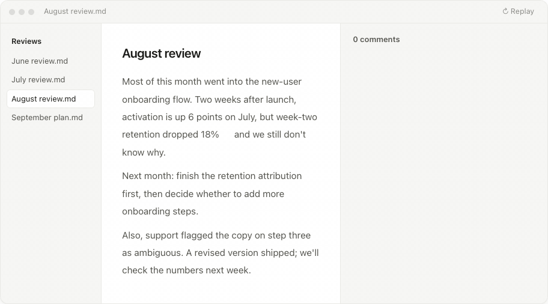
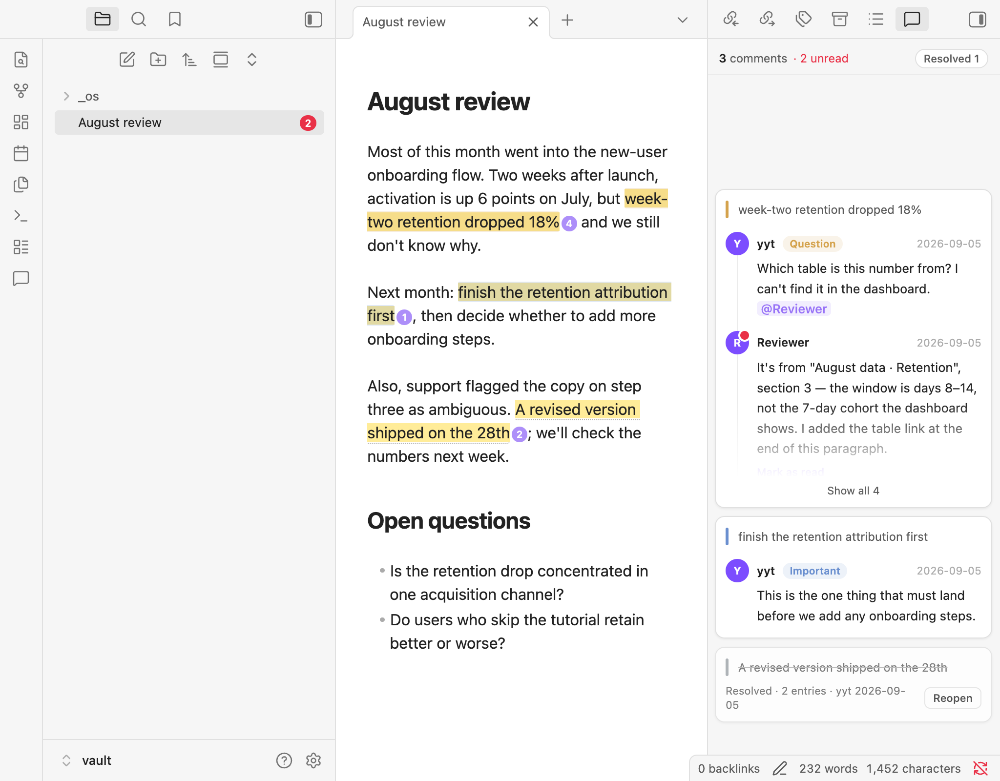
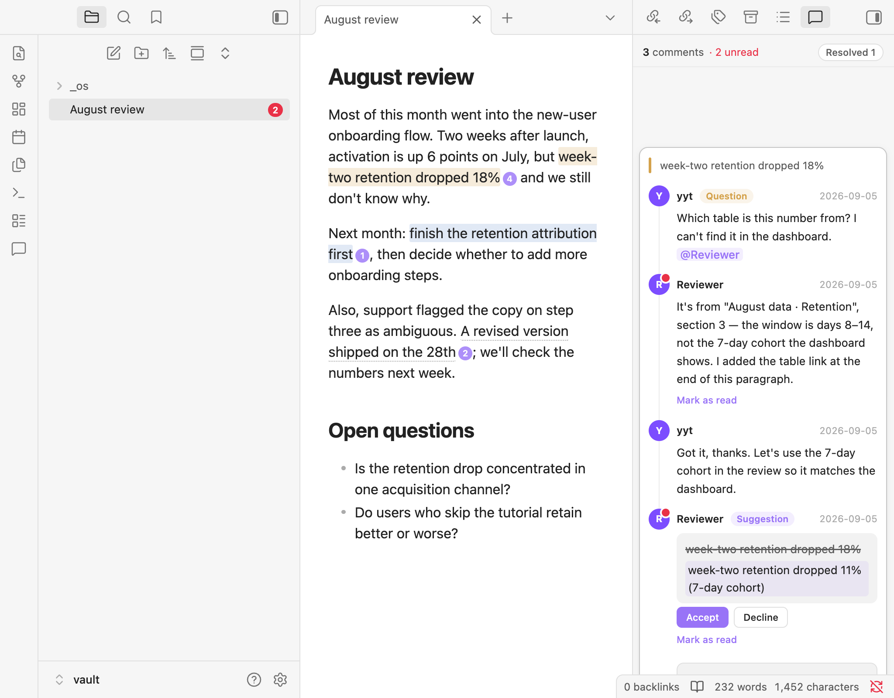
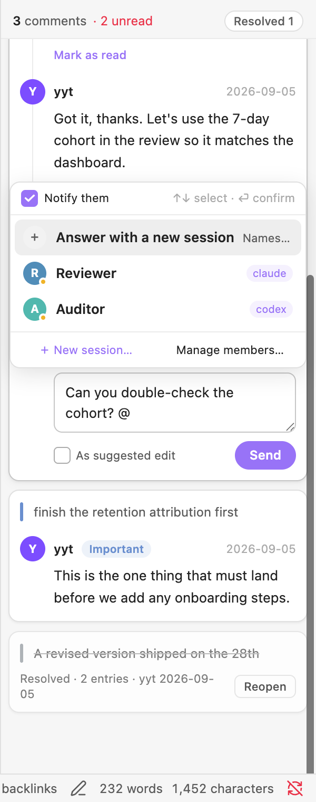

<p align="center">
  
</p>

<h1 align="center">Agent Comments</h1>

<p align="center">
  Comments alongside your notes. <b>@</b> an agent to reply.<br>
  Works on its own; stored as plain text in the Markdown.
</p>

<p align="center">
  <a href="https://community.obsidian.md/plugins/inline-comments"></a>
  <a href="https://github.com/IvyYang1999/obsidian-inline-comments/releases/latest"></a>
  <a href="https://github.com/IvyYang1999/obsidian-inline-comments/releases"></a>
  <a href="LICENSE"></a>
</p>

<p align="center">
  <a href="obsidian://show-plugin?id=inline-comments"><b>Install in Obsidian</b></a> ·
  <a href="https://agent-comments.yytyyf.com/en/">Website</a> ·
  <a href="#中文">中文说明 ↓</a>
</p>

<p align="center">
  
</p>

## What it does

**Highlight → comment.** Select text, right-click *Add inline comment*. A card appears in the right sidebar, level with the passage, and follows it as you scroll. The note itself only gets a soft highlight and a small counter.

**@ a real session.** Type `@` in a comment to pick a running Claude Code / Codex session on your machine — or choose *Answer with a new session* and the plugin starts one with whichever agent CLI you have installed: Claude Code opens in Terminal (macOS), Codex and Gemini CLI answer in the background, each comment resuming the same session. If the Claude Code session is open right now — in the Claude app's Code tab or in a terminal — the letter goes straight into it, queued after whatever it is doing; otherwise (or when the session skips permission prompts, which makes Claude Code refuse messages from other programs) it waits in the session's mailbox and a small hook (installed on request) hands it over the next time the session speaks. The session reads the note and writes its reply back into the file.

**Suggested edits.** A reply can carry a replacement for the highlighted passage — from a person or from the AI session. The card shows old → new with *Accept* / *Decline*; nothing in the note changes until you accept.

**Unread, at a glance.** Replies from other people or AI get a red dot, the panel header shows *N comments · M unread*, and the file explorer shows a red count on the document. Mark as read with one click, resolve a thread when it's done, react with an emoji. One switch turns the unread signals off.

<p align="center">
  
</p>

**Editing and reading view, desktop and mobile.** The same highlight and badge appear in reading view, with the raw markup hidden. Long threads fold to a preview until you expand or focus them.

<p align="center">
  
</p>

**Plain text storage.** A comment is one line of CriticMarkup-style text next to the passage:

```
{==retention dropped 18% in week two==}{>>yyt|2026-09-05|question: Which table is this from? [@Session1](agent:3f9a12c0)<<}
```

No database, no sidecar files. It syncs with iCloud / Git / Obsidian Sync like any other text, diffs cleanly, and stays readable without the plugin.

## Install

Obsidian → Settings → Community plugins → Browse → search **Agent Comments**. Or open <a href="obsidian://show-plugin?id=inline-comments">obsidian://show-plugin?id=inline-comments</a>.

Pre-release builds: [BRAT](https://github.com/TfTHacker/obsidian42-brat) → *Add a beta plugin* → `IvyYang1999/obsidian-inline-comments`.

Obsidian 1.8+, desktop and mobile. Session discovery, the hook, and *Answer with a new session* are desktop features; starting Claude Code in Terminal is macOS only for now.

## Using @

<p align="center">
  
</p>

1. **Manage members** (from the `@` dropdown or the settings tab) lists the Claude Code / Codex sessions running on this machine. Give one a name to make it mentionable — or just `@` a name that doesn't exist yet and the plugin creates the session for you.
2. **Install hook**, once. It adds three entries (`UserPromptSubmit`, `Stop`, `SessionStart`) to `~/.claude/settings.json`, backs the file up first, touches nothing else, and *Uninstall* removes exactly those entries.
3. Write `@Name` in a comment and send. The letter lands in `<vault>/<mailbox root>/<session-id-prefix>/`. A Claude Code session that is open gets it right away, unless it skips permission prompts. Otherwise the session sees it the next time it speaks or finishes. Either way it reads the note and appends a reply.

The plugin never talks to the network. Letters and replies are local files in your vault; handing a letter to an open Claude Code session goes through that session's local inbox socket, the one Claude Code sessions use to message each other. What your AI tool does with the letter is up to that tool.

The UI follows Obsidian's language (English or 中文); you can pin either in settings.

## Settings

| Setting | What it does |
|---|---|
| Author name | Signs your comments; your own replies never count as unread |
| Unread notifications | Master switch for red dots, *Mark as read*, the header count and the explorer badge |
| Show resolved | Keep resolved threads in the panel (collapsed) or hide them |
| Mention delivery / mailbox root | Where letters are written |
| Panel background | Follow sidebar, follow editor, or a custom colour |
| Comment types | Built-in agree / disagree / question / important / note, plus your own with a colour |

## Development

```bash
npm install --legacy-peer-deps
npm run build      # tsc + esbuild → main.js
npm test           # vitest, pure functions
npm run e2e        # boots an isolated Obsidian and runs ~70 UI assertions
```

Design notes live in [`DESIGN.md`](DESIGN.md). Releases are built by CI from a version tag and ship with build-provenance attestations.

---

## 中文

**Agent Comments**——在 Obsidian 笔记的原文旁边留言（划线评论），@ 一个 Agent 来回复。评论以纯文本形式紧挨着原文存在 `.md` 里，不联网、不建库。

- **划线，即评论。** 选中文字右键「添加划线评论」，卡片挂在右侧栏、与原文水平对齐、跟着滚动。
- **@ 一个正在跑的会话。** 打 `@` 点名本机的 Claude Code / Codex 会话，或「用新会话回答」让插件用本机装了的 Agent 替你开一个（Claude Code 在终端里打开；Codex、Gemini CLI 在后台回复，每条留言接着同一个会话）。Claude Code 会话此刻开着（Claude 客户端的 Code 页或终端里）时，留言直接送进去，排在它手头的事后面；没开着、或它跳过了权限确认（这时 Claude Code 不收其他程序发来的消息），就留在信箱，等它下次说话时由 hook 递过去。它读完文档把回复写回原位。
- **修改建议。** 回复可以附带对划线原文的替换文本（人或 AI 都能提），卡片上显示 原文 → 改法，点「采纳」原文才会变。
- **未读一眼看清。** 别人或 AI 的回复带红点，面板顶部常驻「N 条评论 · M 未读」，文件目录里对应文档也挂红色角标；看完点「标为已读」，聊完点「解决」，也可以加个 emoji 反应。设置里「未读通知」一键关掉。
- **编辑与阅读视图、桌面与手机。** 阅读视图里同款高亮 + 角标，原始标记隐藏；超长线程折叠成预览。

**安装**：Obsidian 设置 → 第三方插件 → 浏览，搜 **Agent Comments**；或直接打开 <a href="obsidian://show-plugin?id=inline-comments">obsidian://show-plugin?id=inline-comments</a>。Obsidian 1.8 以上，桌面与手机；会话发现、hook、「用新会话回答」是桌面能力，其中在终端里开 Claude Code 目前仅 macOS。预发布版用 BRAT 添加 `IvyYang1999/obsidian-inline-comments`。

官网中文版：https://agent-comments.yytyyf.com

**关于隐私**：插件本身不联网。@ 只是往你电脑上的一个文件夹写一个文件，会话在你自己的电脑上跑；送进开着的 Claude Code 会话，走的是那个会话的本机收信口（Claude Code 会话之间互发消息用的同一个）；首次 @ 需要在「管理成员」里点一次「安装 hook」——它只往 `~/.claude/settings.json` 加三条，可一键卸载。

作者 [yytyyf](https://yytyyf.com) · MIT
